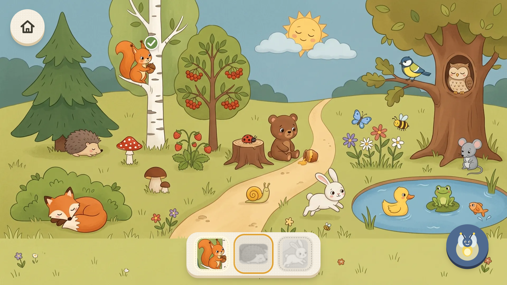
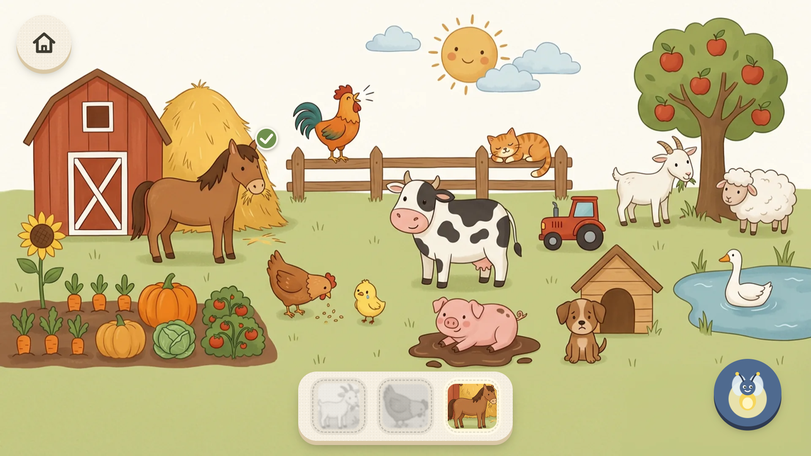
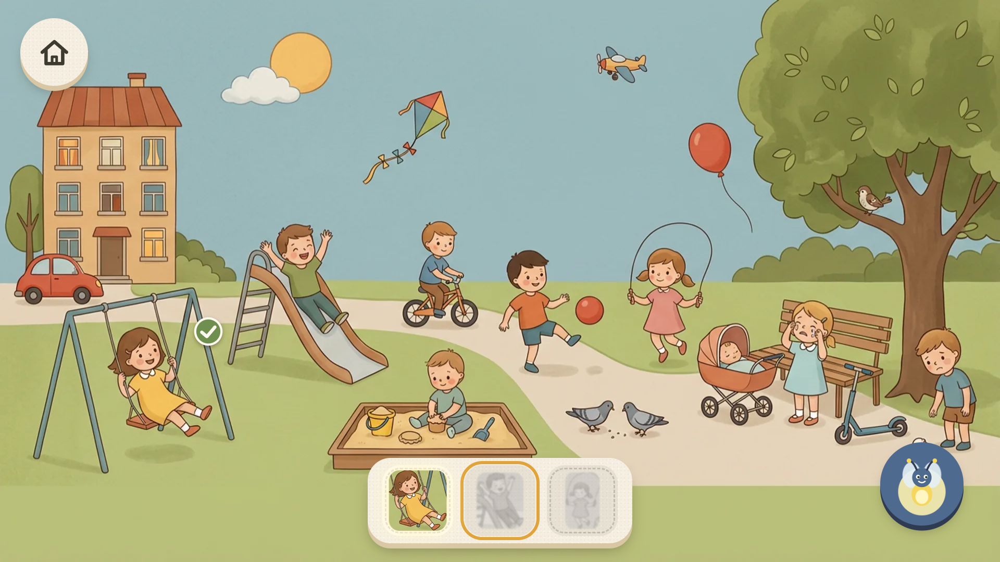

# Говорящие картинки: найди и назови

Детская веб-игра для развития речи, 3–6 лет. Книжка-разглядывалка, которая разговаривает с ребёнком: голос просит найти героя на большой картинке, называет его, рассказывает, что он делает, и предлагает повторить слово вслух («Скажи: бе-лоч-ка!»).

Сделана для [Яндекс Игр](https://yandex.ru/games/); позже планируется RuStore. Сейчас MVP готов, идёт озвучка.



| Ферма | Двор |
|---|---|
|  |  |

## Что внутри

- **3 сцены, 26 уровней:** лес, ферма, двор. Задания идут по ступеням развития речи: кто это → кто так говорит → что делает → какой → где → что чувствует.
- **Голос вместо текста.** Ребёнку не нужно уметь читать: каждое задание звучит, текст на экране только для взрослых.
- **Без негатива.** Нет проигрышей, таймеров и жизней. Неверное касание — маленькое открытие: предмет называет себя.
- **Для неточных пальцев.** Зоны касания больше рисунка и не меньше 52 px, учитывается только первое касание, беспорядочное тапанье превращается в мыльные пузыри, выход из уровня — удержанием.
- **Подсказки по нарастающей:** через 12 с покачивается силуэт, через 25 с светится герой, светлячок показывает цель по просьбе.
- **Родительская зона** за замком («нажмите цифры: семь, два, девять»): вопросы для совместной игры, настройки звука, сброс прогресса.
- Соблюдает «меньше движения» в системе, работает только в горизонтальной ориентации.

Подробно о продукте и аудитории — [PRODUCT.md](PRODUCT.md), полный план — [PLAN.md](PLAN.md), журнал работы — [NIGHT_LOG.md](NIGHT_LOG.md).

## Запуск

Нужен Node.js 22+.

```bash
npm install
npm run dev        # http://localhost:5173
```

| Команда | Что делает |
|---|---|
| `npm run show` | Игра в домашней сети, чтобы открыть с телефона (`http://<IP компьютера>:5180`) |
| `npm test` | Модульные тесты (Vitest): разметка сцен, уровни, ввод, подсказки |
| `npm run build` | Сборка в `dist/` |
| `npm run e2e` | Сквозная проверка в Chrome (Playwright), скриншоты — в `screenshots/` |
| `npm run release` | Сборка и архив для Яндекс Игр (только при полной озвучке) |
| `npm run video` | Видео геймплея 1920×1080 до 28 с → `promo/gameplay.mp4` |
| `npm run promo` | Иконка, обложка и скриншоты для карточки игры |

Неозвученные фразы в режиме разработки читает синтез речи браузера; в релизной сборке его нет.

## Как устроено

- **Стек:** React 19, TypeScript, Vite, Tailwind CSS 4, framer-motion, Howler (Web Audio).
- **Холст 1920×1080** масштабируется под экран; вся геометрия сцен — в процентах, разметка проверяется тестами.
- **Сцены «запечённые»:** один рисунок на сцену, герои вырезаются из фона по прямоугольникам — так полёт находки, слоты и наклейки выглядят как сам рисунок.
- **Площадка за адаптером** (`src/platform/`): мок для localhost и Яндекс Игры (SDK, реклама, сохранения, пауза).

```
src/
  data/scenes/     сцены и уровни (forest, farm, yard)
  data/phrases.ts  все фразы рассказчицы с ударениями
  game/            логика: подбор целей, ввод, подсказки, сохранения
  ui/              экраны и компоненты
  audio/           голос, звуки, музыка
  platform/        мок и Яндекс Игры
scripts/           озвучка, звуки, промо, видео, e2e
```

### Озвучка

Голос — нейросеть Gemini TTS (рассказчица Leda, светлячок Achernar). Готовые mp3 лежат в `src/assets/voice/`.

- `scripts/voice.mjs` — озвучка пачками и нарезка на фразы с защитой от неправдоподобной нарезки;
- `scripts/voice-qa.mjs` — проверка каждого файла расшифровкой, брак удаляется;
- `scripts/voice-level.mjs` — выравнивание громкости (−14 LUFS), темпа и пиков;
- `npm run voice:listen` — страница для прослушивания человеком;
- `scripts/daily-voice.mjs` — всё это раз в день по расписанию Windows.

Для озвучки нужен ключ `GEMINI_API_KEY` в файле `.env` (в репозиторий не попадает).

## Ресурсы и лицензии

- Иллюстрации сгенерированы нейросетью (Gemini через Figma); промпты — [art-prompts/](art-prompts/).
- Звуки животных — BigSoundBank (CC0) и Викисклад (общественное достояние), источники каждого файла — [src/assets/sfx/LICENSES.md](src/assets/sfx/LICENSES.md).
- Шрифты Nunito и Pangolin — SIL Open Font License.

Код и материалы игры: все права защищены. Репозиторий открыт для просмотра.
